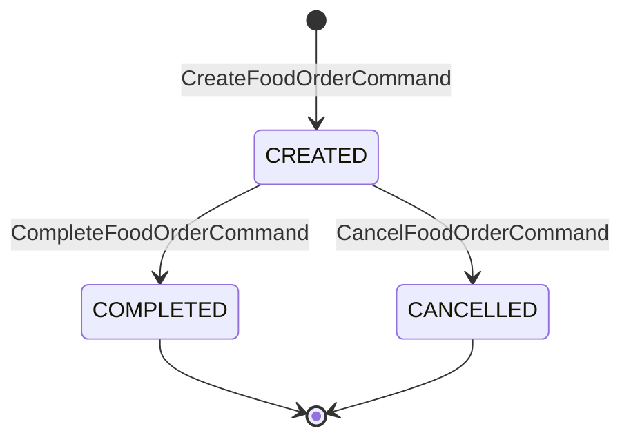

# Phase 1 — Food Order Aggregate Implementation Plan

> **For agentic workers:** Use TDD per [`AGENTS.md`](../../AGENTS.md). Parent roadmap: [`master_plan.md`](master_plan.md) §6.

**Goal:** Make `FoodOrderAggregate` correctly handle create / complete / cancel via event sourcing, with invalid transitions rejected.

**Architecture:** Event-sourced aggregate only. Constructor `@CommandHandler` for create; instance handlers for complete/cancel. Command handlers validate `OrderState` then `AggregateLifecycle.apply(...)`; `@EventSourcingHandler` methods rebuild `orderId` + `state`. No dish field on the aggregate (dish lives on `FoodOrderCreatedEvent` only).

**Tech stack:** Java 21, Axon 4.12 `AggregateTestFixture`, JUnit 5, Maven (`./mvnw test`).

## Global constraints

- Do **not** edit locked `command/`, `event/`, `OrderState`, `Dish`, config, scheduler, `KitchenClient`.
- Touch only: [`FoodOrderAggregate.java`](../../src/main/java/com/nexusgroup/restaurant/aggregate/FoodOrderAggregate.java), [`FoodOrderAggregateTest.java`](../../src/test/java/com/nexusgroup/restaurant/aggregate/FoodOrderAggregateTest.java), and docs (`docs/plans/phase-1-…`, checklist, brief notes in Requirements/AGENTS if needed).
- **Rejection semantics (locked for this phase):** throw `IllegalStateException` when complete/cancel is not allowed from current state. Fixture asserts with `.expectException(IllegalStateException.class)`.
- **Duplicate create:** create is constructor-only; no instance `@CommandHandler` for `CreateFoodOrderCommand`. Completing/cancelling with no prior create is covered via `givenNoPriorActivity` → expect aggregate-not-found style failure (`AggregateNotFoundException` / fixture equivalent). Do not add silent no-ops.
- Out of scope: saga, kitchen, deadlines, e2e, `CookDishCommand` / cook events.

## Aggregate state machine



Invalid: complete/cancel when already `COMPLETED` or `CANCELLED` → `IllegalStateException`.

## Target production shape (implement via TDD, not upfront dump)

[`FoodOrderAggregate.java`](../../src/main/java/com/nexusgroup/restaurant/aggregate/FoodOrderAggregate.java) ends with:

- Fields: `orderId`, `state` (already scaffolded)
- Constructor `@CommandHandler` for `CreateFoodOrderCommand` → apply `FoodOrderCreatedEvent(orderId, dish)`
- `@CommandHandler` complete → require `state == CREATED` → apply `FoodOrderCompletedEvent`
- `@CommandHandler` cancel → require `state == CREATED` → apply `FoodOrderCancelledEvent(orderId, reason)` (propagate reason)
- `@EventSourcingHandler` for created / completed / cancelled updating `orderId` / `state`
- Static import or `AggregateLifecycle.apply`

## Files

| Action | Path |
|--------|------|
| Create on execute | `docs/plans/phase-1-food-order-aggregate.md` (this plan body) |
| Modify | `src/test/.../aggregate/FoodOrderAggregateTest.java` |
| Modify | `src/main/.../aggregate/FoodOrderAggregate.java` |
| Update at phase end | `docs/REQUIREMENTS_CHECKLIST.md` (Phase 1 IDs); short note in `docs/REQUIREMENTS.md` or `AGENTS.md` on `IllegalStateException` rejection |

---

### Task 1: Persist phase plan + remove empty stub

- Write `docs/plans/phase-1-food-order-aggregate.md` from this plan; link it from `master_plan.md` “How to use next” / Phase 1 section.
- Delete the empty `test()` stub in `FoodOrderAggregateTest` once the first real test is added (same commit as Task 2 green).

---

### Task 2: Create order (happy path) — TDD

**Test:** `createsFoodOrder_emitsCreatedEvent`

```java
fixture.givenNoPriorActivity()
       .when(new CreateFoodOrderCommand("order-1", Dish.PANCAKES))
       .expectSuccessfulHandlerExecution()
       .expectEvents(new FoodOrderCreatedEvent("order-1", Dish.PANCAKES));
```

**Run (red):** `./mvnw -Dtest=FoodOrderAggregateTest#createsFoodOrder_emitsCreatedEvent test`  
**Expected red:** no create handler / no events.

**Minimal green:** constructor `@CommandHandler` + `@EventSourcingHandler` for `FoodOrderCreatedEvent` setting `orderId` and `OrderState.CREATED`.

**Verify green** with same Maven command.

---

### Task 3: Complete from CREATED — TDD

**Test:** `completesFoodOrder_whenCreated_emitsCompletedEvent`

```java
fixture.given(new FoodOrderCreatedEvent("order-1", Dish.CHICKEN))
       .when(new CompleteFoodOrderCommand("order-1"))
       .expectSuccessfulHandlerExecution()
       .expectEvents(new FoodOrderCompletedEvent("order-1"));
```

**Green:** `@CommandHandler` for complete (guard `CREATED`) + ES handler → `COMPLETED`.

---

### Task 4: Cancel from CREATED with reason — TDD

**Test:** `cancelsFoodOrder_whenCreated_emitsCancelledEventWithReason`

```java
fixture.given(new FoodOrderCreatedEvent("order-1", Dish.ICE_CREAM))
       .when(new CancelFoodOrderCommand("order-1", "customer changed mind"))
       .expectSuccessfulHandlerExecution()
       .expectEvents(new FoodOrderCancelledEvent("order-1", "customer changed mind"));
```

**Green:** cancel handler applies event with same `reason`; ES → `CANCELLED`.

---

### Task 5: Invalid transitions — TDD (edge cases)

Add these tests (each red → green; guards may already exist from Task 3/4 — if so, tests should pass immediately after writing; if any silent path exists, tighten guards):

1. `complete_whenAlreadyCompleted_throwsIllegalStateException`  
   `given(Created, Completed)` → `when(Complete)` → `expectException(IllegalStateException.class)`
2. `cancel_whenAlreadyCompleted_throwsIllegalStateException`  
   `given(Created, Completed)` → `when(Cancel)` → `expectException(IllegalStateException.class)`
3. `complete_whenAlreadyCancelled_throwsIllegalStateException`  
   `given(Created, Cancelled)` → `when(Complete)` → `expectException(IllegalStateException.class)`
4. `cancel_whenAlreadyCancelled_throwsIllegalStateException`  
   `given(Created, Cancelled)` → `when(Cancel)` → `expectException(IllegalStateException.class)`
5. `complete_withNoPriorCreate_fails`  
   `givenNoPriorActivity()` → `when(CompleteFoodOrderCommand)` → `expectException(AggregateNotFoundException.class)` (or whatever the fixture surfaces for missing aggregate — adjust to actual Axon 4.12 type if different, document in phase plan notes)
6. `cancel_withNoPriorCreate_fails` — same pattern for cancel

Optional assert: `.expectExceptionMessage(...)` only if messages are stable; prefer type-only for less brittleness.

---

### Task 6: Full aggregate test suite + docs closeout

- Run: `./mvnw -Dtest=FoodOrderAggregateTest test` then `./mvnw test` (ensure no regressions; saga/kitchen stubs may still be empty `@Test` — leave them alone this phase).
- Update [`docs/REQUIREMENTS_CHECKLIST.md`](../REQUIREMENTS_CHECKLIST.md): check `FUNC-CREATE-ORDER`, `FUNC-COMPLETE-ORDER`, `FUNC-CANCEL-ORDER`, `FUNC-STATE-TRANSITIONS`, `ARCH-EVENT-SOURCED-AGGREGATE`, `TEST-AGGREGATE-CASES`; refresh summary counts.
- Document rejection choice: one short note under Requirements or AGENTS known gaps — *invalid complete/cancel → `IllegalStateException`*.
- Mark Phase 1 exit criteria done in this plan / pointer in master plan.

## Exit criteria (must all be true)

- Aggregate fixture covers create, complete, cancel+reason, illegal transitions, no-prior-create
- Empty stub `test()` removed
- Checklist IDs above checked
- `./mvnw -Dtest=FoodOrderAggregateTest test` green
- No saga/kitchen/e2e changes

## Explicitly deferred

Kitchen, saga, deadlines, e2e, duplicate-create instance handler, cook events — Phases 2–4.

## Execution notes

- **Rejection:** invalid complete/cancel from non-`CREATED` state throws `IllegalStateException`.
- **No-prior-create:** fixture expects `org.axonframework.modelling.command.AggregateNotFoundException` (confirmed against Axon 4.12 during Task 5).
- **Maven:** project `./mvnw` wrapper properties are missing (`.mvn/wrapper/maven-wrapper.properties`); Phase 1 verification used system `mvn -Dtest=FoodOrderAggregateTest test`.

## Exit criteria status

- [x] Aggregate fixture covers create, complete, cancel+reason, illegal transitions, no-prior-create
- [x] Empty stub `test()` removed
- [x] Checklist IDs checked (`FUNC-CREATE-ORDER`, `FUNC-COMPLETE-ORDER`, `FUNC-CANCEL-ORDER`, `FUNC-STATE-TRANSITIONS`, `ARCH-EVENT-SOURCED-AGGREGATE`, `TEST-AGGREGATE-CASES`)
- [x] Aggregate test suite green (`mvn -Dtest=FoodOrderAggregateTest test`)
- [x] No saga/kitchen/e2e changes
