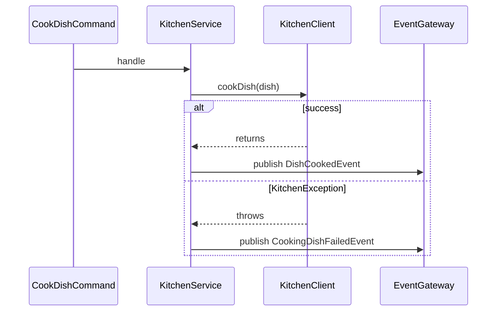

# Phase 2 — Kitchen Cooking Path Implementation Plan

> **For agentic workers:** TDD per [`AGENTS.md`](../../AGENTS.md). Parent roadmap: [`master_plan.md`](master_plan.md) §7.

**Goal:** Implement `KitchenService` so cooking succeeds or fails deterministically in tests and publishes the correct events.

**Architecture:** `KitchenService` remains a Spring `@Component` with `@CommandHandler` for `CookDishCommand`. It calls locked static `KitchenClient.cookDish(dish)`, then publishes via injected `EventGateway`. Success → `DishCookedEvent(orderId)`; `KitchenException` → `CookingDishFailedEvent(orderId, exception.getMessage())`. No aggregate/saga changes.

**Tech stack:** Java 21, Axon 4.12 `EventGateway`, JUnit 5, Mockito (via `spring-boot-starter-test`), Maven (`mvn` — wrapper properties may be missing).

## Global constraints

- Do **not** edit `KitchenClient`, `KitchenException`, commands, events, aggregate, saga.
- Touch: [`KitchenService.java`](../../src/main/java/com/nexusgroup/restaurant/service/KitchenService.java), new [`KitchenServiceTest.java`](../../src/test/java/com/nexusgroup/restaurant/service/KitchenServiceTest.java), docs under `docs/plans/` + checklist.
- **Determinism:** never call the real `KitchenClient.cookDish` in tests (random ~20% failure + `Thread.sleep`). Use `Mockito.mockStatic(KitchenClient.class)`.
- **Failure reason mapping (locked):** `CookingDishFailedEvent.reason` = `KitchenException.getMessage()` (e.g. `"Simulated kitchen failure"` when that is thrown).
- After phase complete: **git commit** (standing user rule).
- Out of scope: saga, deadlines, e2e, pom changes unless tests cannot run without them.

## Flow



## Current scaffolds (read-only context)

[`KitchenService.java`](../../src/main/java/com/nexusgroup/restaurant/service/KitchenService.java) — empty handler, `EventGateway` already injected:

```java
@CommandHandler
public void handle(CookDishCommand cmd) {
}
```

[`KitchenClient`](../../src/main/java/com/nexusgroup/restaurant/service/KitchenClient.java) — locked interface with **static** `cookDish(Dish)`; throws `KitchenException("Simulated kitchen failure")` ~20% or sleeps.

Events: `DishCookedEvent(orderId)`, `CookingDishFailedEvent(orderId, reason)`.

## Target production shape (via TDD)

```java
@CommandHandler
public void handle(CookDishCommand cmd) {
    try {
        KitchenClient.cookDish(cmd.dish());
        eventGateway.publish(new DishCookedEvent(cmd.orderId()));
    } catch (KitchenException ex) {
        eventGateway.publish(new CookingDishFailedEvent(cmd.orderId(), ex.getMessage()));
    }
}
```

Use Axon 4 `EventGateway.publish(...)` overload already on the classpath (object / varargs). Do not catch broader than `KitchenException`.

## Files

| Action | Path |
|--------|------|
| Create on execute | `docs/plans/phase-2-kitchen-service.md` (this plan body) |
| Modify | `docs/plans/master_plan.md` (Phase 2 link) |
| Create | `src/test/.../service/KitchenServiceTest.java` |
| Modify | `src/main/.../service/KitchenService.java` |
| Update at phase end | `docs/REQUIREMENTS_CHECKLIST.md` (Phase 2 IDs); short note in Requirements/AGENTS on failure reason + `mockStatic` |

---

### Task 1: Persist phase plan doc

- Write `docs/plans/phase-2-kitchen-service.md` from this plan.
- Link it from `docs/plans/master_plan.md` Phase 2 section (same pattern as Phase 1).

---

### Task 2: Success path — TDD

**Create** `src/test/java/com/nexusgroup/restaurant/service/KitchenServiceTest.java`:

```java
@ExtendWith(MockitoExtension.class)
class KitchenServiceTest {

    @Mock EventGateway eventGateway;
    KitchenService kitchenService;

    @BeforeEach
    void setUp() {
        kitchenService = new KitchenService(eventGateway);
    }

    @Test
    void handle_whenCookSucceeds_publishesDishCookedEvent() {
        try (MockedStatic<KitchenClient> kitchen = mockStatic(KitchenClient.class)) {
            kitchen.when(() -> KitchenClient.cookDish(Dish.PANCAKES)).thenAnswer(inv -> null);

            kitchenService.handle(new CookDishCommand("order-1", Dish.PANCAKES));

            verify(eventGateway).publish(new DishCookedEvent("order-1"));
            kitchen.verify(() -> KitchenClient.cookDish(Dish.PANCAKES));
        }
    }
}
```

**Run (red):** `mvn -Dtest=KitchenServiceTest#handle_whenCookSucceeds_publishesDishCookedEvent test`  
**Expected red:** empty handler → no publish (or verification failure).

**Green:** implement try path only (call client + publish cooked event).

---

### Task 3: Failure path — TDD

**Test:** `handle_whenKitchenThrows_publishesCookingDishFailedEventWithReason`

```java
@Test
void handle_whenKitchenThrows_publishesCookingDishFailedEventWithReason() {
    try (MockedStatic<KitchenClient> kitchen = mockStatic(KitchenClient.class)) {
        kitchen.when(() -> KitchenClient.cookDish(Dish.CHICKEN))
               .thenThrow(new KitchenException("Simulated kitchen failure"));

        kitchenService.handle(new CookDishCommand("order-2", Dish.CHICKEN));

        verify(eventGateway).publish(
            new CookingDishFailedEvent("order-2", "Simulated kitchen failure"));
        verify(eventGateway, never()).publish(any(DishCookedEvent.class));
    }
}
```

Adjust `never()` / `publish` matchers if Axon `publish` overload makes strict `any(DishCookedEvent.class)` awkward — equivalent: verify only the failed event once and no extra interactions.

**Green:** wrap client call in `try/catch (KitchenException)` and publish failed event with `ex.getMessage()`.

---

### Task 4: Suite + docs + commit

- Run: `mvn -Dtest=KitchenServiceTest,FoodOrderAggregateTest test` then `mvn test` (full suite green; leave saga stub alone).
- Update [`docs/REQUIREMENTS_CHECKLIST.md`](../REQUIREMENTS_CHECKLIST.md): check `FUNC-COOK-HANDLER`, `FUNC-COOK-SUCCESS`, `FUNC-COOK-FAILURE`, `TEST-KITCHEN-SERVICE`; refresh counts.
- Short note in Requirements or AGENTS: failure reason = `KitchenException` message; tests use `mockStatic` (never live randomness).
- Mark Phase 2 exit criteria in phase plan / master plan pointer.
- **Commit** Phase 2 only (HEREDOC message), e.g. `feat: implement Phase 2 kitchen cook success and failure event publishing.`
- Do not push.

## Exit criteria

- [x] Handler non-empty; success and failure paths covered by deterministic unit tests
- [x] Checklist IDs above checked (`FUNC-COOK-HANDLER`, `FUNC-COOK-SUCCESS`, `FUNC-COOK-FAILURE`, `TEST-KITCHEN-SERVICE`)
- [x] Aggregate tests still green
- [x] Git commit created for Phase 2; working tree clean of Phase 2 work

## Deferred

Saga reactions, deadlines, e2e — Phase 3+.
