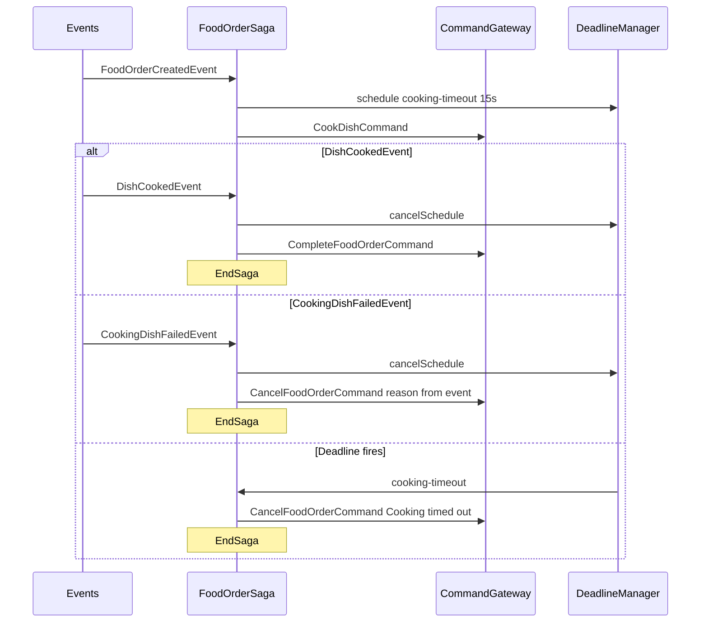

# Phase 3 — Saga Orchestration Implementation Plan

> **For agentic workers:** TDD per [`AGENTS.md`](../../AGENTS.md). Parent roadmap: [`master_plan.md`](master_plan.md) §8.

**Goal:** Implement `FoodOrderSaga` so create → cook → complete/cancel (including cooking timeout) works under `SagaTestFixture`.

**Architecture:** Axon `@Saga` process manager associated by `orderId`. On `FoodOrderCreatedEvent`, schedule a named cooking deadline and send `CookDishCommand`. On `DishCookedEvent`, cancel deadline, send `CompleteFoodOrderCommand`, end saga. On `CookingDishFailedEvent` or deadline expiry, cancel deadline (if still scheduled), send `CancelFoodOrderCommand` with a documented reason, end saga. Keep `commandGateway` / `deadlineManager` `transient` as scaffolded.

**Tech stack:** Java 21, Axon 4.12 `SagaTestFixture` / `DeadlineManager`, JUnit 5, Maven (`mvn`).

## Locked design decisions (Phase 3)

| Decision | Value |
|----------|--------|
| Deadline name | `"cooking-timeout"` |
| Deadline duration | `Duration.ofSeconds(15)` (> max kitchen sleep 10s for `CHICKEN` + buffer) |
| Timeout cancel reason | `"Cooking timed out"` |
| Kitchen-failure cancel reason | Propagate `CookingDishFailedEvent.reason()` unchanged |
| Duplicate outcomes / events after `@EndSaga` | Deferred to Phase 5 (document in AGENTS known gaps) |

## Global constraints

- Do **not** edit locked commands/events, aggregate, kitchen client, config, scheduler.
- Touch: [`FoodOrderSaga.java`](../../src/main/java/com/nexusgroup/restaurant/saga/FoodOrderSaga.java), [`FoodOrderSagaTest.java`](../../src/test/java/com/nexusgroup/restaurant/saga/FoodOrderSagaTest.java), docs under `docs/plans/` + checklist / Requirements / AGENTS notes.
- Remove empty stub `test()` once real tests exist.
- After phase: **git commit** (standing rule). No push.
- Out of scope: Spring e2e (Phase 4), optional hardening (Phase 5).

## Flow



## Target production shape (via TDD)

[`FoodOrderSaga.java`](../../src/main/java/com/nexusgroup/restaurant/saga/FoodOrderSaga.java):

- Fields: `transient` gateways (existing); persistable `String orderId`; `String cookingDeadlineId` (schedule id from `DeadlineManager.schedule`)
- Constants: `COOKING_DEADLINE = "cooking-timeout"`; `COOKING_TIMEOUT = Duration.ofSeconds(15)`; `TIMEOUT_REASON = "Cooking timed out"`
- `@StartSaga` + `@SagaEventHandler(associationProperty = "orderId")` on `FoodOrderCreatedEvent` → store `orderId`, `cookingDeadlineId = deadlineManager.schedule(COOKING_TIMEOUT, COOKING_DEADLINE)`, `commandGateway.send(new CookDishCommand(orderId, dish))`
- `@SagaEventHandler(associationProperty = "orderId")` + `@EndSaga` on `DishCookedEvent` → cancel deadline if id present → `CompleteFoodOrderCommand`
- Same pattern on `CookingDishFailedEvent` → `CancelFoodOrderCommand(orderId, event.reason())`
- `@DeadlineHandler(deadlineName = COOKING_DEADLINE)` + `@EndSaga` → `CancelFoodOrderCommand(orderId, TIMEOUT_REASON)`
- Private `cancelCookingDeadline()` calling `deadlineManager.cancelSchedule(COOKING_DEADLINE, cookingDeadlineId)` when id non-null

Use Axon 4 imports: `@StartSaga`, `@EndSaga`, `@SagaEventHandler`, `@DeadlineHandler`.

---

### Task 1: Persist phase plan doc

- Write this file; link from master plan §8.

---

### Task 2: Created → cook + schedule deadline — TDD

**Test:** `onFoodOrderCreated_dispatchesCookDishCommand_andSchedulesCookingDeadline`

```java
fixture.givenNoPriorActivity()
       .whenPublishingA(new FoodOrderCreatedEvent("order-1", Dish.PANCAKES))
       .expectActiveSagas(1)
       .expectDispatchedCommands(new CookDishCommand("order-1", Dish.PANCAKES))
       .expectScheduledDeadlineWithName(Duration.ofSeconds(15), "cooking-timeout");
```

**Run (red):** `mvn -Dtest=FoodOrderSagaTest#onFoodOrderCreated_dispatchesCookDishCommand_andSchedulesCookingDeadline test`

**Green:** implement `@StartSaga` handler only (schedule + send cook).

---

### Task 3: Cooked → complete + end — TDD

**Test:** `onDishCooked_dispatchesComplete_andEndsSaga`

```java
fixture.givenAPublished(new FoodOrderCreatedEvent("order-1", Dish.CHICKEN))
       .whenPublishingA(new DishCookedEvent("order-1"))
       .expectDispatchedCommands(new CompleteFoodOrderCommand("order-1"))
       .expectActiveSagas(0)
       .expectNoScheduledDeadlines();
```

**Green:** cooked handler cancels deadline, completes, `@EndSaga`.

---

### Task 4: Cooking failed → cancel with reason + end — TDD

**Test:** `onCookingFailed_dispatchesCancelWithReason_andEndsSaga`

```java
fixture.givenAPublished(new FoodOrderCreatedEvent("order-2", Dish.ICE_CREAM))
       .whenPublishingA(new CookingDishFailedEvent("order-2", "Simulated kitchen failure"))
       .expectDispatchedCommands(
           new CancelFoodOrderCommand("order-2", "Simulated kitchen failure"))
       .expectActiveSagas(0)
       .expectNoScheduledDeadlines();
```

**Green:** failed handler cancels deadline, cancel command with event reason, `@EndSaga`.

---

### Task 5: Deadline timeout → cancel + end — TDD

**Test:** `whenCookingDeadlineElapses_dispatchesCancelTimedOut_andEndsSaga`

```java
fixture.givenAPublished(new FoodOrderCreatedEvent("order-3", Dish.BEANS_ON_TOAST))
       .whenTimeElapses(Duration.ofSeconds(15))
       .expectDispatchedCommands(
           new CancelFoodOrderCommand("order-3", "Cooking timed out"))
       .expectActiveSagas(0);
```

**Green:** `@DeadlineHandler(deadlineName = "cooking-timeout")` + `@EndSaga`.

---

### Task 6: Docs, full suite, commit

- Run `mvn -Dtest=FoodOrderSagaTest,FoodOrderAggregateTest,KitchenServiceTest test` then `mvn test`.
- Checklist check: `FUNC-SAGA-START`, `FUNC-SAGA-COMPLETE`, `FUNC-SAGA-CANCEL-ON-FAIL`, `FUNC-DEADLINES`, `NFR-RESILIENCE-CANCEL`, `TEST-SAGA-CASES`; refresh counts. Leave `TEST-EDGE-CASES` for Phase 4; timeout edge covered under `TEST-SAGA-CASES`.
- Document in Requirements/AGENTS: deadline name, 15s duration, `"Cooking timed out"` vs kitchen `event.reason()` propagation.
- Mark Phase 3 exit criteria in this plan / master plan.
- **Commit:** e.g. `feat: implement Phase 3 food order saga cook orchestration with cooking timeout.` Do not push.

## Exit criteria

- [x] Four saga fixture scenarios green (created, cooked, failed, timeout); empty stub gone
- [x] Checklist IDs above checked; deadline/reason decisions documented
- [x] Aggregate + kitchen tests still green
- [x] Phase 3 git commit created

## Deferred

E2E Spring wiring (Phase 4); duplicate kitchen outcomes / post-end events (Phase 5).
