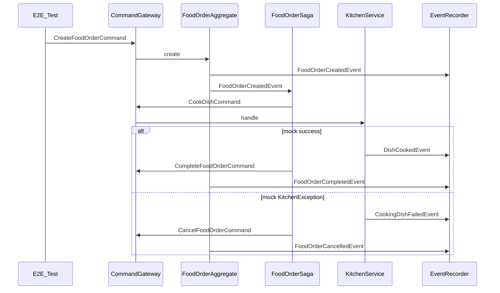

# Phase 4 — Wiring & E2E Implementation Plan

> **For agentic workers:** TDD per [`AGENTS.md`](../../AGENTS.md). Parent roadmap: [`master_plan.md`](master_plan.md) §9.

**Goal:** Prove Aggregate + Saga + `KitchenService` work when wired by Spring Boot: happy path completes; kitchen failure cancels — without Docker/Axon Server UI and without flaky live kitchen.

**Architecture:** `@SpringBootTest` loads [`RestaurantApplication`](../../src/main/java/com/nexusgroup/restaurant/RestaurantApplication.java) under profile `test`. Disable Axon Server, Docker Compose, and scheduling. Provide an **in-memory** `EventStore` so aggregates/sagas run without Axon Server. Drive flows with `CommandGateway.sendAndWait(CreateFoodOrderCommand)`. Keep real `KitchenService` / saga / aggregate; make kitchen deterministic via `Mockito.mockStatic(KitchenClient.class)`. Assert lifecycle with a test `@EventHandler` recorder + Awaitility. **Timeout e2e deferred to Phase 5** (already unit-covered in Phase 3).

**Tech stack:** Java 21, Spring Boot 3.5 `@SpringBootTest`, Axon 4.12 (`EmbeddedEventStore` + `InMemoryEventStorageEngine`), JUnit 5, Mockito static mocks, Awaitility (from `spring-boot-starter-test`), Maven (`mvn`).

## Locked design decisions

| Decision | Choice |
|----------|--------|
| Test style | Spring Boot integration (`@SpringBootTest`), not fixture-only |
| Infra | `axon.axonserver.enabled=false` + in-memory EventStore; **no** Testcontainers / live Axon Server for this phase |
| Determinism | `mockStatic(KitchenClient.class)` — never real sleep/~20% failure |
| Scheduler | `spring.task.scheduling.enabled=false` so locked `FoodOrderScheduler` does not inject random orders |
| Assertions | Test `OrderFlowEventRecorder` `@Component` with `@EventHandler` per domain event + `Awaitility` |
| Timeout e2e | **Deferred to Phase 5**; document in phase plan / AGENTS |
| Production code | Prefer **tests + test config only**; touch production only if Spring context cannot start (justify) |

## Global constraints

- Do not edit locked packages (`config/`, `scheduler/`, `command/`, `event/`, `KitchenClient`, `RestaurantApplication`, value types).
- Do not add REST or security.
- After phase: **git commit**. No push.

## Flow under test



## Files to create

| Path | Role |
|------|------|
| [`docs/plans/phase-4-wiring-e2e.md`](phase-4-wiring-e2e.md) | Phase plan copy |
| [`src/test/resources/application-test.yml`](../../src/test/resources/application-test.yml) | Test profile props |
| [`src/test/java/.../e2e/AxonInMemoryTestConfig.java`](../../src/test/java/com/nexusgroup/restaurant/e2e/AxonInMemoryTestConfig.java) | In-memory EventStore beans |
| [`src/test/java/.../e2e/OrderFlowEventRecorder.java`](../../src/test/java/com/nexusgroup/restaurant/e2e/OrderFlowEventRecorder.java) | Collects domain events |
| [`src/test/java/.../e2e/FoodOrderFlowE2ETest.java`](../../src/test/java/com/nexusgroup/restaurant/e2e/FoodOrderFlowE2ETest.java) | Happy + failure tests |

### `application-test.yml` (exact intent)

```yaml
axon:
  axonserver:
    enabled: false
  serializer:
    general: jackson
    events: jackson

spring:
  docker:
    compose:
      enabled: false
  task:
    scheduling:
      enabled: false

jobrunr:
  background-job-server:
    enabled: false
```

Keep JobRunr `StorageProvider` from locked config if context still needs it; disabling the background job server avoids extra threads. If Axon’s JobRunr-based `DeadlineManager` fails to start with BGS off, register a test `@Bean` `SimpleDeadlineManager` (scope: saga still schedules/cancels deadlines on create/outcome — manager must exist even when not asserting timeout).

### `AxonInMemoryTestConfig`

```java
@TestConfiguration
public class AxonInMemoryTestConfig {
    @Bean
    @Primary
    public EventStorageEngine eventStorageEngine() {
        return new InMemoryEventStorageEngine();
    }

    @Bean
    @Primary
    public EmbeddedEventStore eventStore(EventStorageEngine engine) {
        return EmbeddedEventStore.builder().storageEngine(engine).build();
    }
}
```

Adjust bean signatures if AF 4.12 auto-config requires `ConfigurerModule` / `AxonConfiguration` customization instead — implement the smallest fix that lets `@SpringBootTest` start with `axon.axonserver.enabled=false`. Prefer `@Primary` overrides over excluding starter modules.

### `OrderFlowEventRecorder`

- `@Component` in test sources (component-scanned via `@SpringBootTest` on `RestaurantApplication` — put under `com.nexusgroup.restaurant.e2e`)
- Concurrent queues/lists for: `FoodOrderCreatedEvent`, `DishCookedEvent`, `CookingDishFailedEvent`, `FoodOrderCompletedEvent`, `FoodOrderCancelledEvent`
- `@EventHandler` methods append; `clear()` / `reset()` for isolation
- Helpers: `awaitCompleted(orderId)`, `awaitCancelled(orderId)`, etc. using Awaitility (`atMost(Duration.ofSeconds(5))`)

### `FoodOrderFlowE2ETest`

```java
@SpringBootTest
@ActiveProfiles("test")
@Import(AxonInMemoryTestConfig.class) // if not picked up automatically
class FoodOrderFlowE2ETest {
    @Autowired CommandGateway commandGateway;
    @Autowired OrderFlowEventRecorder recorder;
    // ...
}
```

---

### Task 1: Persist phase plan + test profile skeleton

- Write phase-4 plan doc; link from master plan §9.
- Add `application-test.yml` as above.

---

### Task 2: TDD — context boots + happy path (red → green)

**Failing test first:** `createOrder_whenKitchenSucceeds_completesOrder`

```java
@Test
void createOrder_whenKitchenSucceeds_completesOrder() {
    recorder.reset();
    String orderId = "e2e-success-1";
    try (MockedStatic<KitchenClient> kitchen = mockStatic(KitchenClient.class)) {
        kitchen.when(() -> KitchenClient.cookDish(any())).thenAnswer(inv -> null);

        commandGateway.sendAndWait(new CreateFoodOrderCommand(orderId, Dish.PANCAKES));

        await().atMost(Duration.ofSeconds(5)).untilAsserted(() -> {
            assertThat(recorder.created()).anyMatch(e -> orderId.equals(e.orderId()));
            assertThat(recorder.cooked()).anyMatch(e -> orderId.equals(e.orderId()));
            assertThat(recorder.completed()).anyMatch(e -> orderId.equals(e.orderId()));
            assertThat(recorder.cancelled()).noneMatch(e -> orderId.equals(e.orderId()));
        });
    }
}
```

**Expected red:** context fails (no EventStore) and/or no completion events.

**Green:** add `AxonInMemoryTestConfig` + recorder + any minimal DeadlineManager/saga wiring fix required for context start. Do **not** change locked files.

---

### Task 3: TDD — failure path

**Test:** `createOrder_whenKitchenFails_cancelsOrderWithReason`

```java
kitchen.when(() -> KitchenClient.cookDish(any()))
       .thenThrow(new KitchenException("Simulated kitchen failure"));
commandGateway.sendAndWait(new CreateFoodOrderCommand(orderId, Dish.CHICKEN));
// await CookingDishFailedEvent + FoodOrderCancelledEvent with reason "Simulated kitchen failure"
// assert no FoodOrderCompletedEvent for orderId
```

**Green:** should mostly work once happy path wiring exists; fix only if event processing order/async tracking needs tweaks (e.g. `TrackingEventProcessor` / subscribing processor — prefer subscribing in tests if tracking is slow; only change via test config).

---

### Task 4: Close checklist, docs, full suite, commit

- Run `mvn test` (all unit + e2e green).
- Check: `FUNC-ALL-COMMANDS-EVENTS`, `TEST-E2E`, `TEST-EDGE-CASES` (suite now covers kitchen fail, timeout unit, invalid transitions, cancel reasons), `TEST-TDD`, `DOC-SYNC`.
- Confirm/check `API-NO-REST` and `SEC-NONE-SPECIFIED` as N/A/out of scope if still open.
- Document in Requirements/AGENTS: e2e uses in-memory Axon + `mockStatic`; timeout e2e deferred to Phase 5.
- Mark Phase 4 exit criteria in phase plan / master plan.
- **Commit:** `feat: add Phase 4 Spring Boot e2e tests for order complete and cancel flows.` Do not push.

## Exit criteria

- [x] Happy + failure e2e green without Docker/Axon Server
- [x] Full command/event set exercised across the two tests
- [x] Checklist Phase 4 IDs checked; docs synced
- [x] Unit suite still green; Phase 4 commit created

### Wiring notes (as implemented)

- Provide only `@Primary` `InMemoryEventStorageEngine`; Axon Boot builds `EmbeddedEventStore` (do not register a second store bean — dual stores broke tracking).
- `ConfigurerModule` + yaml set **subscribing** processors for saga and `com.nexusgroup.restaurant.e2e` recorder (tracking missed events in tests).
- JobRunr `DeadlineManager` starts with background job server disabled; no `SimpleDeadlineManager` override needed.
- No production code changes.

## Deferred to Phase 5

- Timeout/deadline path in e2e
- Duplicate kitchen outcomes after `@EndSaga`
