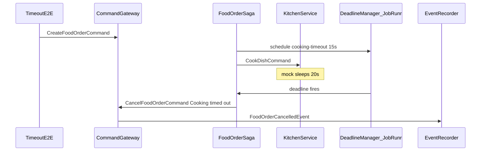

# Phase 5 — Hardening, Makefile & README Implementation Plan

> **For agentic workers:** TDD per [`AGENTS.md`](../../AGENTS.md). Parent roadmap: [`master_plan.md`](master_plan.md) §10.

**Goal:** Close deferred Phase 4 edges (timeout e2e + post-`@EndSaga` kitchen events), add a root **Makefile** and **README.md** for day-to-day commands, sync docs/gaps, commit.

**Architecture:** Keep production saga behavior (Axon ends saga on `@EndSaga` / deadline — late kitchen events should dispatch **no** further commands). Add one dedicated Spring e2e class that enables JobRunr background job server so `"cooking-timeout"` can fire while a mocked cook blocks. Operator UX: Makefile wraps Maven/Docker; README at repo root points to `docs/` and `AGENTS.md`.

**Tech stack:** Existing Spring/Axon test stack + Make + Markdown.

## Locked design decisions

| Decision | Choice |
|----------|--------|
| Timeout e2e | New [`FoodOrderTimeoutE2ETest`](../../src/test/java/com/nexusgroup/restaurant/e2e/FoodOrderTimeoutE2ETest.java); `jobrunr.background-job-server.enabled=true` for that class only; mock `KitchenClient.cookDish` to sleep **20s** (blocks cook, does not complete); await `FoodOrderCancelledEvent` with `"Cooking timed out"` within **25s**; assert no `FoodOrderCompletedEvent` |
| Late kitchen events | **Saga unit tests only** — after saga ended (cooked or failed), publishing another kitchen event → `expectActiveSagas(0)` + no new complete/cancel commands. No production change unless a test fails and proves a handler still runs |
| Makefile | Root [`Makefile`](../../Makefile); use `mvn` (wrapper properties historically missing); document `./mvnw` as optional alternative in README |
| README | Create root [`README.md`](../../README.md) (allowed outside `docs/`); do not move Requirements into README — link them |
| Logging polish | Skip unused `@Slf4j` cleanup unless touching those files anyway — YAGNI |

## Global constraints

- Do not edit locked packages.
- No REST/security.
- After phase: **git commit**. No push.
- Timeout e2e is slow (~15–25s) — isolate in its own class so the default context (BGS off) stays cached for fast e2e.

## Flow (timeout e2e)

---

### Task 1: Persist phase plan doc

- Write this file; link from master plan §10.

---

### Task 2: TDD — late kitchen events after saga end (unit)

In [`FoodOrderSagaTest.java`](../../src/test/java/com/nexusgroup/restaurant/saga/FoodOrderSagaTest.java):

1. `afterCompleted_lateCookingFailed_dispatchesNoCommands`
   - Given created + `DishCookedEvent` (saga ended)
   - When `CookingDishFailedEvent`
   - Expect `expectActiveSagas(0)` and `expectNoDispatchedCommands()`

2. `afterCancelled_lateDishCooked_dispatchesNoCommands`
   - Given created + cooking failed (saga ended)
   - When `DishCookedEvent`
   - Expect no complete command / no active saga

**Red → green:** Prefer green with **zero** production changes (Axon `@EndSaga`). Only if fixture shows handlers still fire, add the smallest guard.

---

### Task 3: TDD — timeout e2e

Create [`FoodOrderTimeoutE2ETest.java`](../../src/test/java/com/nexusgroup/restaurant/e2e/FoodOrderTimeoutE2ETest.java):

- `@SpringBootTest(properties = "jobrunr.background-job-server.enabled=true")`
- `@ActiveProfiles("test")` + `@Import(AxonInMemoryTestConfig.class)`
- Test: `createOrder_whenCookingExceedsDeadline_cancelsWithTimeoutReason`
- Prefer `send` over `sendAndWait`; mock cook sleeps 20s; await cancel `"Cooking timed out"` ≤25s; no completed event

**Run:** `mvn -Dtest=FoodOrderTimeoutE2ETest test` (expect ~20s+).

---

### Task 4: Makefile

Root `Makefile` targets: `help` (default), `test`, `test-unit`, `test-e2e`, `verify`, `run`, `docker-up`, `docker-down`, `clean`, `package`. Use `.PHONY` for all; recipes use `mvn`.

---

### Task 5: README.md

Root `README.md`: what this is, stack, quick start (`make docker-up` → Axon UI → `make run`), Make targets table, docs map, locked surfaces pointer, testing notes (timeout e2e ~20s+). Pointer in [`docs/REQUIREMENTS.md`](../REQUIREMENTS.md) Getting Started.

---

### Task 6: Docs closeout + full suite + commit

- Update `AGENTS.md` known gaps: timeout e2e and post-`@EndSaga` duplicates **resolved**.
- Update checklist / master plan Phase 5 exit criteria.
- Run `make test` / `mvn test` — full suite green including slow timeout test.
- **Commit:** `feat: Phase 5 hardening with timeout e2e, Makefile, and README.` Do not push.

## Exit criteria

- [x] Late-event saga fixtures green; timeout e2e green (cancel reason `"Cooking timed out"`)
- [x] `Makefile` and `README.md` present and accurate
- [x] AGENTS known gaps updated; docs linked
- [x] Full `mvn test` / `make test` green; Phase 5 commit created

### Implementation notes (as shipped)

- Late kitchen events: saga fixtures only; Axon `@EndSaga` — **no production saga change**.
- Timeout e2e: JobRunr BGS on for that class; `AsynchronousCommandBus` so saga lock releases while cook blocks; `@MockBean KitchenService` sleeps 20s (static `KitchenClient` mock is thread-local); `@MockBean FoodOrderScheduler` because `@EnableScheduling` still fires despite `spring.task.scheduling.enabled=false`.

## Out of scope

- REST, security, unlocking locked packages, changing deadline duration/name, rewriting production DI on saga to constructors.
